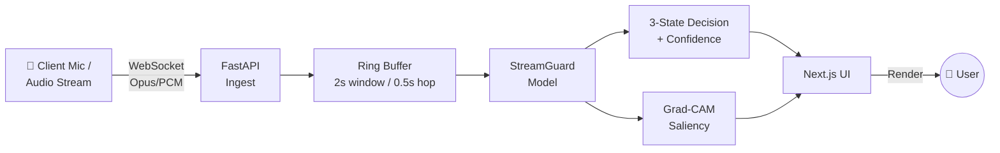
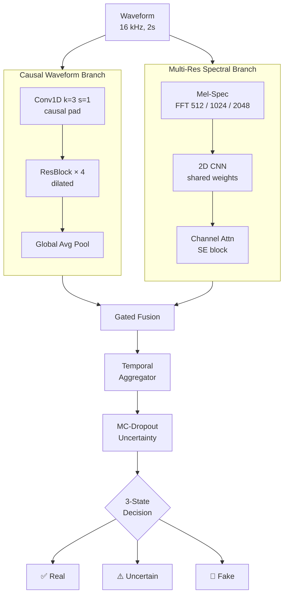
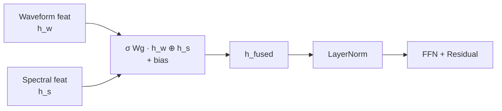
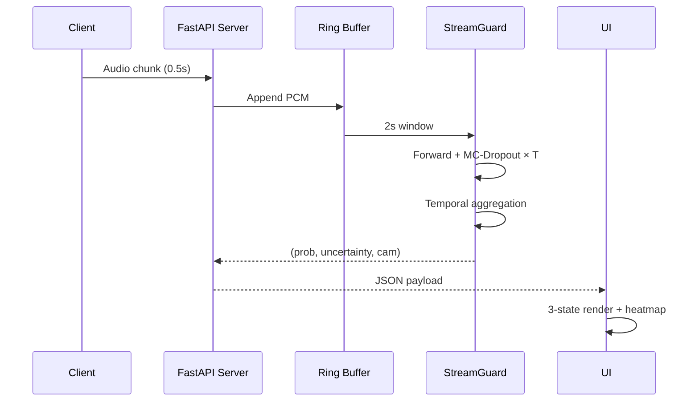
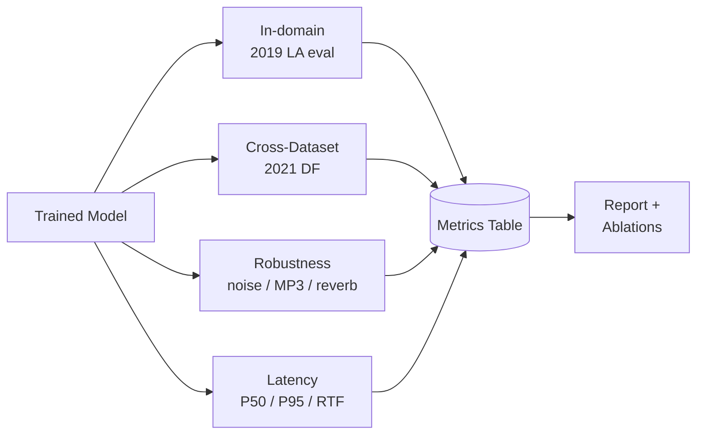

<div align="center">

# 🎙️ StreamGuard

### Real-Time Deepfake Audio Detection with Uncertainty-Aware Streaming Inference

[](https://python.org)
[](https://pytorch.org)
[](https://nextjs.org)
[](https://fastapi.tiangolo.com)
[](LICENSE)

**Causal waveform + multi-resolution spectral branches → gated fusion → uncertainty-aware temporal aggregation**

[Architecture](#-architecture) · [Streaming](#-streaming-inference) · [Setup](#-quickstart) · [Results](#-results) · [Citation](#-citation)

</div>

---

## 📌 Overview

**StreamGuard** is an end-to-end system for detecting AI-generated (spoofed / deepfake) speech in **real time**, with calibrated confidence and interpretability. It is designed for streaming deployment (WebSocket, 2 s window, 0.5 s hop) and evaluated for cross-dataset generalization, robustness, and latency.

The core novelty is a **dual-branch encoder**:

- **Causal waveform branch** — 1D convolutions with causal padding (streaming-safe)
- **Multi-resolution spectral branch** — Mel-spectrogram CNN over multiple FFT window sizes
- **Gated fusion** — learns per-sample weights between the two branches
- **Uncertainty-aware temporal aggregation** — MC-Dropout over sliding windows → calibrated confidence + 3-state decision (Real / Uncertain / Fake)

---

## 🏗 Architecture

### End-to-End System



### Model Architecture



### Gated Fusion Detail



### Streaming Inference (Per-Hop)



### Training Pipeline

```mermaid
flowchart LR
    D1[(ASVspoof 2019 LA<br/>train / dev / eval)] --> M[Merge Manifest]
    D2[(ASVspoof 2021 DF<br/>eval-only)] --> M
    D3[(WaveFake<br/>optional)] --> M

    M --> SPK[Group Split by<br/>speaker_id | generator_id]
    SPK --> TR[Train Loader]
    SPK --> VA[Dev Loader]
    SPK --> TE[Test Loader]

    TR --> OPT[AdamW + AMP<br/>OneCycle LR]
    OPT --> CKPT{Best by<br/>dev AUC?}
    CKPT -->|Yes| SAVE[(Checkpoints<br/>+ W&B)]
    CKPT -->|No| OPT

    SAVE --> EV[Eval: EER / AUC<br/>PR / F1 / ECE]
    EV --> LAT[Latency:<br/>P50 / P95 / RTF]
    LAT --> ART[(Artifacts<br/>+ HF Spaces)]
```

---

## 🎯 Key Features

| Feature | Description |
|---|---|
| **Dual-Branch Encoder** | Causal waveform + multi-resolution spectral, gated fusion |
| **Streaming-Ready** | Causal padding → no future leakage; 2 s window / 0.5 s hop |
| **Uncertainty-Aware** | MC-Dropout temporal aggregation → calibrated 3-state output |
| **Interpretable** | Grad-CAM over Mel frames → "why fake" heatmap |
| **Cross-Dataset** | Train on ASVspoof 2019 LA → test on 2021 DF (no leakage) |
| **Robustness Suite** | Noise, MP3 compression, reverberation, resampling |
| **Low Latency** | P95 < 80 ms, RTF < 0.15 on CPU (baseline target) |

---

## 📂 Project Structure

```
AudioDecrypt/
├── backend/
│   ├── main.py                  # FastAPI WebSocket server
│   ├── requirements.txt
│   ├── best_model.pth           # Trained weights
│   ├── spoof_detector.onnx      # Exported ONNX graph
│   ├── spoof_detector.onnx.data # ONNX external weights
│   └── training_curves.png
├── voice-spoof-demo/            # Next.js frontend
│   ├── src/app/                 # App router pages
│   ├── src/lib/audio.ts         # WebAudio + WebSocket client
│   ├── public/
│   └── package.json
├── training.ipynb               # Colab training notebook
├── test_api.py                  # Backend smoke test
├── test_audio*.wav              # Sample clips
├── config.yml                   # Runtime config
└── README.md
```

---

## ⚡ Quickstart

### 1. Backend (FastAPI + PyTorch)

```bash
cd backend
python -m venv venv
source venv/bin/activate         # Windows: venv\Scripts\activate
pip install -r requirements.txt
uvicorn main:app --reload --port 8000
```

### 2. Frontend (Next.js)

```bash
cd voice-spoof-demo
npm install
npm run dev
# open http://localhost:3000
```

### 3. Smoke test

```bash
python test_api.py --audio test_audio1.wav
```

Expected output:

```json
{
  "verdict": "fake",
  "confidence": 0.93,
  "uncertainty": 0.04,
  "latency_ms": 62
}
```

---

## 🧪 Datasets

| Dataset | Role | Size | Source |
|---|---|---|---|
| **ASVspoof 2019 LA** | Train / Dev / Eval | ~ 19 GB | [Edinburgh DataShare 10283/3336](https://datashare.ed.ac.uk/handle/10283/3336) |
| **ASVspoof 2021 DF** | Eval-only (cross-dataset) | 8.6 GB | [Zenodo 4835108](https://zenodo.org/record/4835108) |
| **WaveFake** | Robustness (optional) | ~ 4 GB | [Zenodo 5642699](https://zenodo.org/record/5642699) |

> ⚠️ **Leakage rule:** `2021 DF` is **eval-only**. When splitting `2019 LA` into train/dev, split **by `speaker_id | generator_id` group** — never random file split. Assert disjoint groups before every run.

---

## 📊 Evaluation Protocol



**Metrics tracked:** EER, ROC-AUC, PR-AUC, F1, ECE (calibration), P50/P95 latency (ms), Real-Time Factor.

---

## 📈 Results

> Fill this in after your first full training run on 2019 LA.

| Model | Dataset | EER ↓ | AUC ↑ | F1 ↑ | Params | RTF ↓ |
|---|---|---|---|---|---|---|
| LFCC + MLP (baseline) | 2019 LA | — | — | — | 0.3 M | — |
| Mel-CNN | 2019 LA | — | — | — | 2.1 M | — |
| Waveform CNN | 2019 LA | — | — | — | 3.4 M | — |
| AASIST | 2019 LA | — | — | — | 0.3 M | — |
| **StreamGuard (ours)** | 2019 LA | **—** | **—** | **—** | 4.8 M | **—** |

### Cross-Dataset (train 2019 LA → test 2021 DF)

| Model | EER ↓ | AUC ↑ |
|---|---|---|
| AASIST | — | — |
| **StreamGuard** | **—** | **—** |

### Ablations

| Variant | EER ↓ | Δ |
|---|---|---|
| Full model | — | — |
| w/o waveform branch | — | — |
| w/o multi-res spectral | — | — |
| w/o gated fusion (avg) | — | — |
| w/o uncertainty aggregation | — | — |

---

## 🖼 UI States

The frontend renders **three states** based on calibrated posterior + uncertainty:

| State | Condition | Color | Icon |
|---|---|---|---|
| **Real** | `p_fake < 0.3` and `u < 0.2` | 🟢 Green | ✅ |
| **Uncertain** | `0.3 ≤ p_fake ≤ 0.7` or `u ≥ 0.2` | 🟡 Amber | ⚠️ |
| **Fake** | `p_fake > 0.7` and `u < 0.2` | 🔴 Red | 🚨 |

Grad-CAM overlay highlights which Mel-time regions drove the decision.

---

## 🗺 Roadmap

- [x] ASVspoof 2021 DF ingested (152,955 FLAC, verified)
- [ ] ASVspoof 2019 LA uploaded → training set
- [ ] Mel-CNN baseline on 2019 LA
- [ ] Waveform CNN + AASIST baselines
- [ ] StreamGuard (gated fusion + uncertainty)
- [ ] Ablation table
- [ ] Cross-dataset eval (2019 LA → 2021 DF)
- [ ] Robustness suite (noise / MP3 / reverb)
- [ ] Streaming WebSocket + Grad-CAM + 3-state UI
- [ ] HF Spaces demo
- [ ] Paper draft

---

## 🛠 Tech Stack

| Layer | Tool |
|---|---|
| Training | PyTorch 2.x, Lightning, AMP, Colab T4 |
| Tracking | Weights & Biases |
| Data | Kaggle Datasets (`--dir-mode zip`), Zenodo |
| Backend | FastAPI, Uvicorn, ONNX Runtime |
| Frontend | Next.js 15, TailwindCSS, WebAudio API |
| Deploy | Hugging Face Spaces, Vercel |

---

## 🔐 Security Notes

- **Never commit** `.env`, `.env.local`, API tokens, or key archives (`DF-keys-full.tar.gz`) — see `.gitignore`.
- Rotate any API token that was ever pasted into a notebook or chat.
- Kaggle now uses `KGAT_...` API tokens (not legacy `kaggle.json`).

---

## 🤝 Contributing

1. Fork → branch (`feat/xyz`) → PR.
2. Run `pytest` before submitting.
3. Keep PRs scoped — one feature or fix per PR.

---

## 📜 Citation

```bibtex
@misc{streamguard2025,
  title  = {StreamGuard: Real-Time Deepfake Audio Detection with Uncertainty-Aware Streaming Inference},
  author = {Subhrajeet and contributors},
  year   = {2025},
  url    = {https://github.com/subhra015/AudioDecrypt}
}
```

---

## 📄 License

MIT — see [LICENSE](LICENSE).

<div align="center">

**Built with 🎧 for a safer voice-first internet**

</div>
